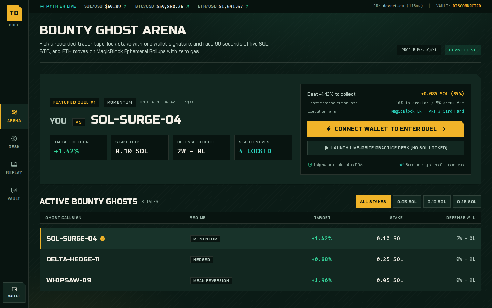
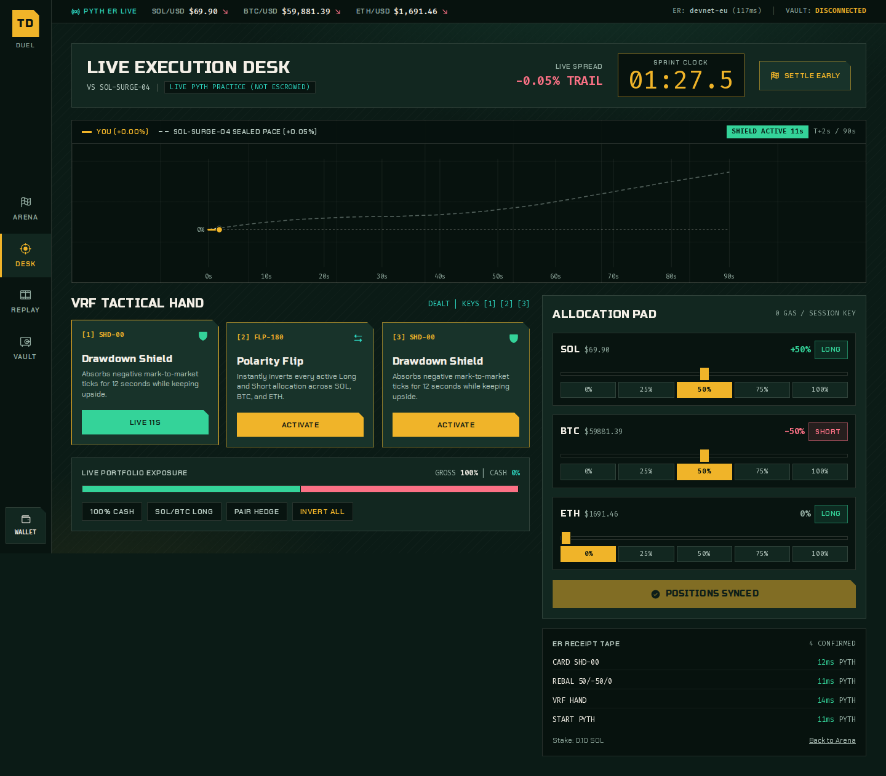
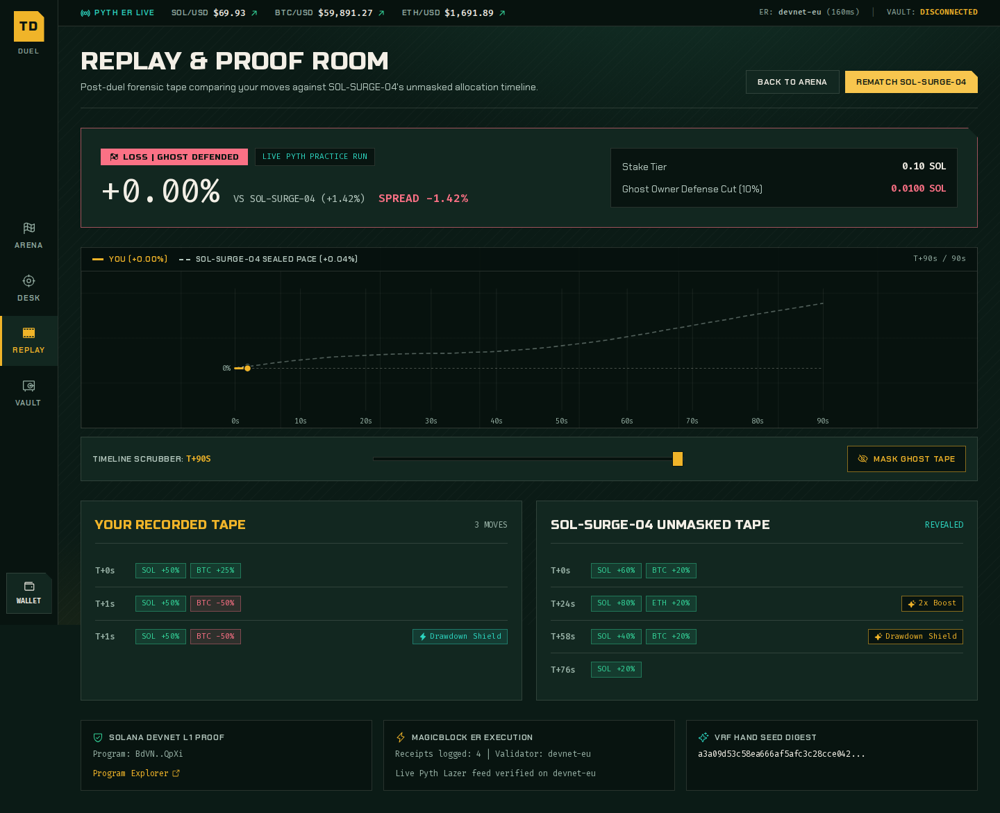
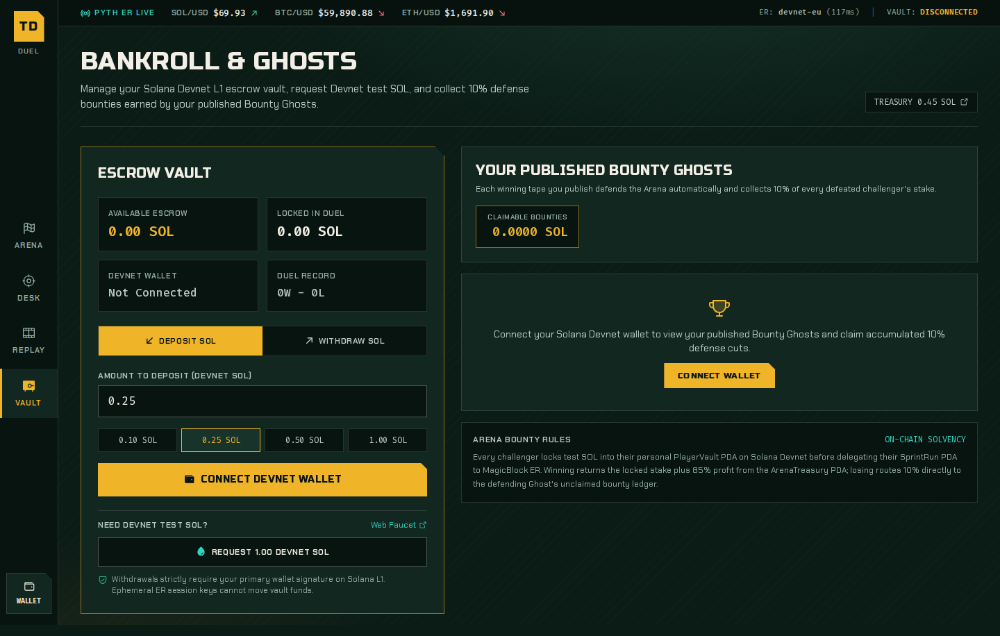
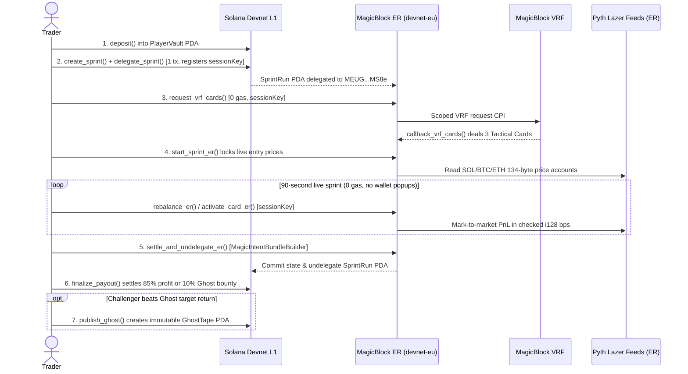

# TapeDuel

[](https://tapeduel.vercel.app/)
[](https://explorer.solana.com/address/BdVNbT73iebJ3w396FeWiu3cvcQbe4fG1EZ138d1QpXi?cluster=devnet)
[](https://docs.magicblock.gg)
[](https://www.anchor-lang.com/)
[](https://nextjs.org/)
[](./LICENSE)

**Live Demo:** [https://tapeduel.vercel.app/](https://tapeduel.vercel.app/)

**TapeDuel** is an asynchronous 90-second live market portfolio duel on Solana Devnet and MagicBlock Ephemeral Rollups (ER), built for **MagicBlock Solana Blitz V10: Entertainment Finance**.

Instead of waiting for another live trader in a matchmaking lobby, you challenge an on-chain **Bounty Ghost** (a previously recorded trader's sprint tape). One wallet signature locks your stake in a Solana Devnet escrow vault and delegates your `SprintRun` PDA to a MagicBlock ER validator. Inside the ER, **MagicBlock VRF** deals a verifiable 3-card tactical hand (`2x Boost`, `Drawdown Shield`, `Polarity Flip`), and your browser session key fires rapid zero-gas rebalances across `SOL`, `BTC`, `ETH`, and `Cash` priced against real-time **MagicBlock Pyth Lazer** feeds. At `00:00`, the sprint settles and undelegates back to Solana L1, unmasks the Ghost's hidden moves alongside yours, and lets winners publish their tape as a new Bounty Ghost that collects a **10% defense bounty** every time a future challenger loses to it.



---

## Why TapeDuel Needs MagicBlock

Standard Solana L1 transactions require wallet confirmation popups, transaction fees, and ~400ms+ slots, which breaks a 90-second active trading sprint where players rebalance and fire tactical cards every few seconds. TapeDuel uses three pieces of the MagicBlock stack together:

1. **MagicBlock Ephemeral Rollups (`devnet-eu.magicblock.app`)**: A single L1 transaction creates and delegates the player's `SprintRun` PDA. Every rebalance, tactical card activation, and final settlement inside the 90-second window executes on ER with zero gas fees and zero wallet popups using a sprint-scoped browser session key.
2. **MagicBlock VRF (`Vrf1RNUjXmQGjmQrQLvJHs9SNkvDJEsRVFPkfSQUwGz`)**: Deals the 3-card tactical hand inside the ER via `#[vrf]` and `#[vrf_callback]` bound to a compile-time scoped program identity PDA, making every hand cryptographically verifiable and impossible to pre-select.
3. **MagicBlock Real-Time Pyth Lazer Feeds (`PriCems5tHihc6UDXDjzjeawomAwBduWMGAi8ZUjppd`)**: Reads live ticking `SOL/USD`, `BTC/USD`, and `ETH/USD` accounts directly inside ER handlers to mark portfolio PnL to market in checked `i128` basis points on every move.

---

## Product Walkthrough & Screenshots

### 1. Arena Lobby (`/`)

Browse active on-chain **Bounty Ghosts**, filter by stake tier (`0.05`, `0.10`, `0.25` SOL), inspect each Ghost's target return and defense record (`W-L`), and enter a 90-second duel with one wallet signature. Users without a funded Devnet wallet can also launch the **Live-Price Practice Desk** against real ticking MagicBlock Pyth Lazer prices.


### 2. Live Execution Desk (`/sprint/[id]`)

Full-width recessed oscilloscope tracking your live Championship Gold equity curve against the Ghost's sealed pace line across 90 seconds. Below the chart sits the 3D-flipping **VRF Tactical Hand** (with `[1]`, `[2]`, `[3]` keyboard shortcuts), the **Rapid-Fire Allocation Pad** (`Long` / `Short` toggles, stepped presets, gross-exposure guard), and a live **ER Receipt Tape** logging confirmed sub-second execution latencies and Explorer links.



### 3. Replay & Proof Room (`/tapes/[id]`)

Once the sprint commits and undelegates back to Solana Devnet L1, the Replay & Proof Room displays the settlement verdict, an interactive `0-90s` timeline scrubber, and a `clip-path` **Ghost Unmask** comparing your recorded moves side by side with the Ghost's previously hidden timeline. Every completed run surfaces clickable Solana Devnet L1, MagicBlock ER, and VRF seed proofs, plus a one-click **Publish as Bounty Ghost** form for winning runs.



### 4. Bankroll & Ghosts (`/vault`)

Manage your Solana Devnet L1 `PlayerVault` escrow balance (`Deposit` / `Withdraw`), request test SOL through the built-in Devnet airdrop helper, monitor live `ArenaTreasury` solvency, and claim accumulated **10% defense bounties** earned by your published Bounty Ghosts.



---

## System Architecture



---

## On-Chain Program Reference

### Program & MagicBlock Endpoints

| Component | Address / Endpoint |
|---|---|
| TapeDuel Program ID (Devnet) | `BdVNbT73iebJ3w396FeWiu3cvcQbe4fG1EZ138d1QpXi` |
| MagicBlock ER Validator (`devnet-eu`) | `MEUGGrYPxKk17hCr7wpT6s8dtNokZj5U2L57vjYMS8e` (`https://devnet-eu.magicblock.app`) |
| MagicBlock Delegation Program | `DELeGGvXpWV2fqJUhqcF5ZSYMS4JTLjteaAMARRSaeSh` |
| MagicBlock VRF Program | `Vrf1RNUjXmQGjmQrQLvJHs9SNkvDJEsRVFPkfSQUwGz` |
| MagicBlock ER VRF Queue | `5hBR571xnXppuCPveTrctfTU7tJLSN94nq7kv7FRK5Tc` |
| Pyth Lazer Price Program | `PriCems5tHihc6UDXDjzjeawomAwBduWMGAi8ZUjppd` |
| `SOL/USD` Live ER Feed | `ENYwebBThHzmzwPLAQvCucUTsjyfBSZdD9ViXksS4jPu` |
| `BTC/USD` Live ER Feed | `71wtTRDY8Gxgw56bXFt2oc6qeAbTxzStdNiC425Z51sr` |
| `ETH/USD` Live ER Feed | `5vaYr1hpv8yrSpu8w3K95x22byYxUJCCNCSYJtqVWPvG` |

### PDAs & Economic Splits

| Account PDA | Seeds | Purpose |
|---|---|---|
| `ArenaConfig` | `["arena"]` | Global authority, sprint counter, Ghost counter, total volume |
| `ArenaTreasury` | `["treasury"]` | Solvency reserve paying `+85%` winner profits and holding unclaimed `10%` Ghost defense bounties |
| `PlayerVault` | `["vault", player]` | Per-player L1 SOL escrow (`available_lamports`, `locked_lamports`, career `W-L`, `sprint_nonce`) |
| `GhostTape` | `["ghost", ghost_id_le]` | Immutable Bounty Ghost (`callsign`, `target_return_bps`, up to 16 moves, `wins`/`losses`, `unclaimed_bounty_lamports`) |
| `SprintRun` | `["sprint", player, nonce_le]` | Delegated duel state (`session_key`, live weights, `pnl_bps`, VRF hand, active card timer, recorded moves) |

**Settlement Payout Rules:**
- **Challenger Wins (`sprint.pnl_bps > ghost.target_return_bps`):** Locked stake returns to `PlayerVault` plus `+85%` profit from `ArenaTreasury`.
- **Ghost Defends (`sprint.pnl_bps <= ghost.target_return_bps`):** Locked stake routes `10%` into `ghost.unclaimed_bounty_lamports` (claimable anytime by the Ghost creator via `claim_bounty`) and `90%` into `ArenaTreasury` (covering future payouts and the `5%` protocol spread).

### Tactical Cards (Dealt by MagicBlock VRF)

| Card | Code | Effect |
|---|---|---|
| **2x Boost** | `BST-2X` | Doubles mark-to-market PnL velocity for 15 seconds |
| **Drawdown Shield** | `SHD-00` | Absorbs negative mark-to-market ticks for 12 seconds while keeping positive gains |
| **Polarity Flip** | `FLP-180` | Instantly negates all 3 active allocations (`[sol, btc, eth] -> [-sol, -btc, -eth]`) |

---

## Verified Live Solana Devnet & MagicBlock ER Proofs

All transactions below were executed live on Solana Devnet and `devnet-eu.magicblock.app` against deployed program `BdVNbT73iebJ3w396FeWiu3cvcQbe4fG1EZ138d1QpXi`:

| Verification Step | Cluster | Explorer Proof |
|---|---|---|
| Deployed Program (`tapeduel`) | Solana Devnet | [`BdVNbT7...1QpXi`](https://explorer.solana.com/address/BdVNbT73iebJ3w396FeWiu3cvcQbe4fG1EZ138d1QpXi?cluster=devnet) |
| Seeded Bounty Ghost #1 (`SOL-SURGE-04`) | Solana Devnet | [`AeLuHnN...oxSjKX`](https://explorer.solana.com/address/AeLuHnNmpbmxW4rtr3hKiagRWVJEJCbwutyBRjoxSjKX?cluster=devnet) |
| Seeded Bounty Ghost #2 (`DELTA-HEDGE-11`) | Solana Devnet | [`8Sa3gdo...7ycoLN`](https://explorer.solana.com/address/8Sa3gdoQHyRB4MKEXpmnnyxLaQdh2jBBzKjK8T7ycoLN?cluster=devnet) |
| Seeded Bounty Ghost #3 (`WHIPSAW-09`) | Solana Devnet | [`7xNHZYZ...x1ctw`](https://explorer.solana.com/address/7xNHZYZ8634QzY2zuDPUNFvUGLjgeQVRV59JE3Kx1ctw?cluster=devnet) |
| Single-Tx `create_sprint` + `delegate_sprint` | Solana Devnet | [`3kcb2sQ...rW4B6T`](https://explorer.solana.com/tx/3kcb2sQ1njxGhHU921p3FkPJbunsNQMv6vgvXEGJsih8NcaA16PJiNzeQFQyt8HQPc5u5MBkHZ11Eo88osrW4B6T?cluster=devnet) |
| `request_vrf_cards` (`Cards dealt: [1, 2, 2]`) | MagicBlock ER EU | [`4dRuR25...emXZXte`](https://explorer.solana.com/tx/4dRuR25ovdJ4m9H5py9Z2ZasaNfZk2wYzf7hvh3aa1tYndcPMfnbzRKPpbY6G3yRxp4Bcg95tdTrmGXFLemXZXte?cluster=custom&customUrl=https%3A%2F%2Fdevnet-eu.magicblock.app) |
| `start_sprint_er` (Live Pyth Entry) | MagicBlock ER EU | [`3CNhcRx...jhRQGLes`](https://explorer.solana.com/tx/3CNhcRx1hdjjDvDYWjhuzhJCkXuQWCu4UgoUB2XVZnrdeqy63vKqbCjn9RJuP1tWuAcpj8KQNJRKGM5jhRQGLes?cluster=custom&customUrl=https%3A%2F%2Fdevnet-eu.magicblock.app) |
| Gasless `rebalance_er` (Session Key) | MagicBlock ER EU | [`4FoG4sf...WmWcq984`](https://explorer.solana.com/tx/4FoG4sfqsCS1xiUijneDYxTMCeZ318LwNjXas4pbjaUhj7V697kSE7Fok2k9zi7UPfWx5gikEh3q3gssWmWcq984?cluster=custom&customUrl=https%3A%2F%2Fdevnet-eu.magicblock.app) |
| Gasless `activate_card_er` (`2x Boost`, `240ms`) | MagicBlock ER EU | [`2Vd22gN...FPsArLsK`](https://explorer.solana.com/tx/2Vd22gN2SqrPGUNAJ7p4MAp2C7ezUFkLUTdgnn1HvEzFPnKiaZWA8kUP3agygsyoxDXYAaGznpdBgjMMFPsArLsK?cluster=custom&customUrl=https%3A%2F%2Fdevnet-eu.magicblock.app) |
| `settle_and_undelegate_er` (`+4 bps`) | MagicBlock ER EU | [`46f7hzw...JEuAY96T`](https://explorer.solana.com/tx/46f7hzwKyu3jysA3DyCzsBL16Z64RiiNU5hpNPTNVj62JPShJmPDbGU2K3eQRbJukqQRwPQbpUggxJTqJEuAY96T?cluster=custom&customUrl=https%3A%2F%2Fdevnet-eu.magicblock.app) |
| L1 `finalize_payout` Settlement | Solana Devnet | [`43sSMKp...GPdSFNj`](https://explorer.solana.com/tx/43sSMKpjdZFUywTUFMBZgBGsvYxagkuvB7jSbACbX3TuSmq4GVTG6Zpr3KReg2G4TYdRzBrp98BAH3E8GPdSFNj?cluster=devnet) |

---

## Security & Engineering Invariants

- **Strict Session Key Scope**: Ephemeral browser Ed25519 keys stored in `sessionStorage` are accepted only by ER gameplay instructions (`request_vrf_cards`, `start_sprint_er`, `rebalance_er`, `activate_card_er`, `settle_and_undelegate_er`). L1 `withdraw`, `deposit`, `publish_ghost`, and `claim_bounty` strictly require the primary wallet signer.
- **Compile-Time VRF Identity PDA**: `SCOPED_VRF_IDENTITY` is precomputed as a Rust `const` (`scoped_vrf_identity_const(&ID)`) inside `CallbackVrfCards`, eliminating ~267k runtime compute units from pure-Rust Ed25519 derivation and guaranteeing `#[vrf_callback]` executes comfortably inside ER callback compute budgets.
- **Oracle Account Validation**: Every ER pricing handler validates exact `SOL_USD_FEED`, `BTC_USD_FEED`, and `ETH_USD_FEED` addresses, verifies program ownership by `PriCems5tHihc6UDXDjzjeawomAwBduWMGAi8ZUjppd`, rejects non-positive prices, and computes weighted returns using checked `i128` arithmetic with single-tick clamping.
- **Verified Borsh Account Layouts**: Automated Rust unit tests assert exact byte-for-byte equality between `borsh::to_vec(&account).len()` and `Account::SIZE` across all 5 Anchor structs, and TypeScript SDK tests assert exact discriminator and account-count parity against `idl/tapeduel.json`.

---

## Repository Layout

```text
tapeduel/
├── app/                      # Next.js 16 App Router pages (/, /sprint/[id], /tapes/[id], /vault)
├── components/
│   ├── arena/                # Featured Match Stage & horizontal Bounty Ghost bands
│   ├── providers/            # Solana Wallet Standard provider + live Pyth ER context
│   ├── replay/               # Settlement verdict, Ghost unmask sweep, Explorer proof strip
│   ├── shell/                # Fixed 84px Left Paddock Rail, mobile bottom dock, Pyth strip
│   ├── sprint/               # Dual-curve Oscilloscope, 3D VRF Hand, Allocation Pad
│   └── vault/                # L1 Escrow console, Devnet airdrop helper, bounty claims
├── docs/screenshots/         # Live Devnet desktop screenshots
├── idl/tapeduel.json         # Generated Anchor 1.2.2 IDL
├── lib/solana/               # Borsh codec, PDA helpers, Pyth Lazer decoder, L1/ER client
├── programs/tapeduel/        # Rust Anchor program + 12 unit tests
├── scripts/                  # Live Devnet Arena seeder & full ER/VRF/Pyth E2E verifier
├── DESIGN.md                 # Approved Direction v2 design system specification
└── LICENSE                   # MIT License
```

---

## Local Development & Testing

### Prerequisites

- Node.js 22+ and `pnpm`
- Rust toolchain, Solana CLI (Agave), and Anchor CLI `1.2.2`

### Install & Run Frontend

```bash
pnpm install
pnpm dev
```

Open `http://localhost:3000`. All Devnet and MagicBlock ER defaults are preconfigured in `lib/solana/config.ts` (see `.env.example` for optional overrides).

### Run Verification Suites

```bash
# 12 Rust unit tests (Borsh sizes, PnL math, Boost/Shield/Flip cards, solvency)
cargo test --manifest-path programs/tapeduel/Cargo.toml

# 5 TypeScript SDK tests (IDL discriminator parity + live MagicBlock ER Pyth Lazer probe)
pnpm test:sdk

# Strict TypeScript check + production Next.js build
pnpm typecheck && pnpm build
```

### Build, Deploy & Seed on Solana Devnet

```bash
# Compile size-optimized Solana SBF program
anchor build --no-idl

# Deploy to Solana Devnet
anchor deploy --provider.cluster devnet

# Initialize Arena, fund Treasury, seed 3 Bounty Ghosts, and run full live ER/VRF/Pyth E2E sprint
pnpm devnet:seed
```

---

## Deploy to Vercel

1. Import `Pizzylee001/tapeduel` in Vercel with **Root Directory** left at `.` (Next.js is auto-detected).
2. Optional environment variables (all have working Devnet defaults):
   - `NEXT_PUBLIC_SOLANA_RPC_URL`
   - `NEXT_PUBLIC_MAGICBLOCK_ER_RPC_URL`
   - `NEXT_PUBLIC_MAGICBLOCK_ER_WS_URL`
   - `NEXT_PUBLIC_MAGICBLOCK_ER_VALIDATOR`
   - `NEXT_PUBLIC_TAPEDUEL_PROGRAM_ID`
3. Click **Deploy**.

---

## License

Released under the [MIT License](./LICENSE).
